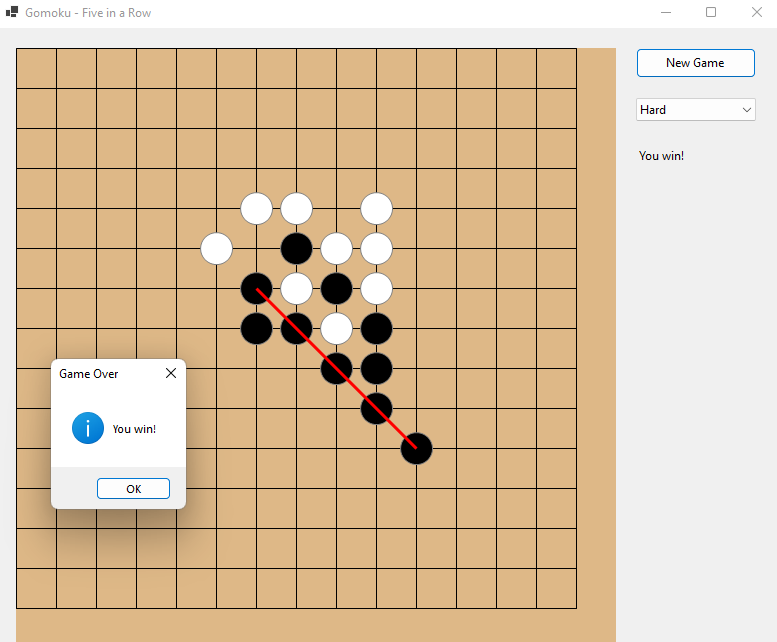
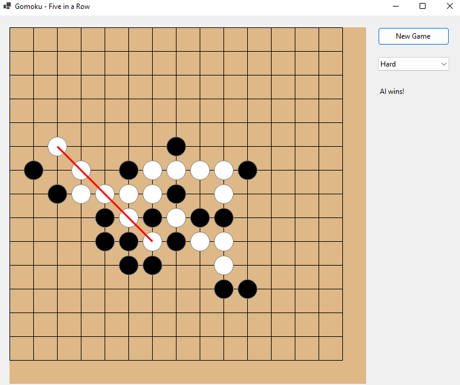

# gomoku

Gomoku is a strategic board game in which two players take turns laying stones on the board. The goal of the game is to first construct a continuous row of five stones horizontally, vertically or diagonally.

## Structure

The solution has four projects:

| Project | What it is |
| --- | --- |
| `gomoku` | Domain: board, rules, game state. No dependencies. |
| `gomoku.AI` | The computer opponent: threat detection, position evaluation, minimax search. |
| `gomoku.UI` | WinForms front end. **This is the one you run.** |

Dependencies run one way: `gomoku` <- `gomoku.AI` <- `gomoku.UI`.

## Running

Requires the .NET 8 SDK (or newer) on Windows.

```bash
dotnet run --project gomoku.UI -c Release
```

## The Game Process

Basic rules:
- Board: 15×15 cells

- Player: Black stones (go first)

- AI: White stones

- Goal: Build a row of 5 stones

- Directions: Horizontal, vertical, diagonal

Control:
- Left click to place the stone

- New Game - start a new game

- Difficulty - select AI difficulty level





## How the AI picks a move

Three difficulty levels map to search depth:

| Level | Depth | Behaviour |
| --- | --- | --- |
| Easy | 1 | Ranks candidate moves by a single evaluation, no search. |
| Medium | 2 | Minimax with alpha-beta pruning. |
| Hard | 3 | Same search, one ply deeper. |

Before searching, the AI checks for forcing moves in order: win in one, block the opponent's win in one, then a double open three (a fork that cannot be answered with a single stone). If one exists it plays it immediately, because no amount of searching will find anything better.

Otherwise every candidate move is scored from both sides at once — the threat it *creates* for us plus the threat it *denies* the opponent. Scoring only the first half is what makes an engine build its own shapes while walking into the opponent's.

### Score scale

All scores live on one scale, defined in `gomoku.AI/Evaluation/Scores.cs`. The invariant that matters:

```
Win (10,000,000)  >  MaxHeuristic (1,000,000)  >=  any positional score
```

A position score can never reach a win score. Without that separation the search will happily trade an actual win for a position that merely looks excellent.

### Shape recognition

`gomoku.AI/ThreatDetection/ThreatPatterns.cs` reads a 9-cell line centred on the move — enough, since any five through the centre fits within ±4 — and classifies it by asking *how many different moves complete a five*:

- **open four** — two different squares complete a five; the opponent cannot block both
- **closed four** — exactly one such square
- **open three** — some move produces an open four
- **closed three** — some move produces a closed four
- twos follow the same rule, one level down

This is what separates `.xx.x.` from `.xxx.`. Counting stones inside a five-cell window cannot: both look like "four of five", so playing into the gap and playing off the edge score the same — even though the gap yields an unstoppable open four and the edge only a closed one. Results are memoised in a 19,683-entry table (9 cells, 3 states each), so each distinct shape is classified once.
